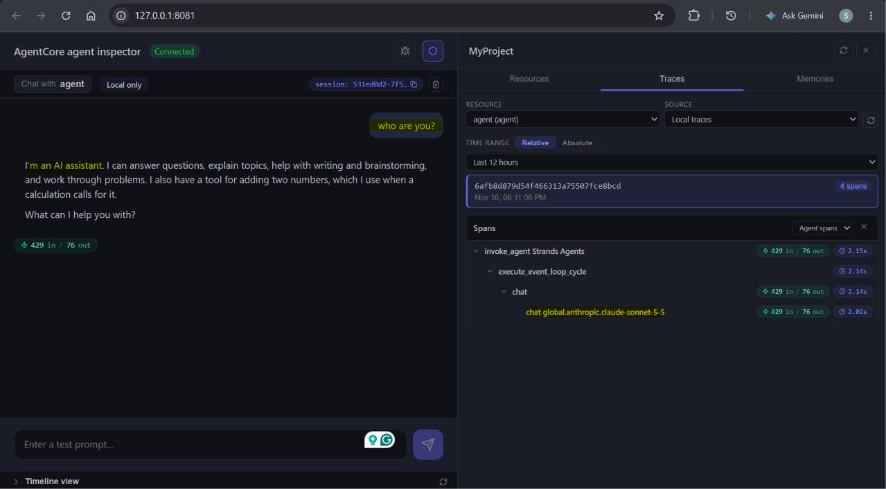

# AgentCore: Getting start

[Back](../README.md)

- [AgentCore: Getting start](#agentcore-getting-start)
  - [Create project](#create-project)
    - [Understand the created files](#understand-the-created-files)
  - [Test locally](#test-locally)
  - [Build \& Deploy](#build--deploy)

---

## Create project

- ref: https://docs.aws.amazon.com/bedrock-agentcore/latest/devguide/agentcore-get-started-cli.html
  - Project name: MyProject
  - template: Python Strands
  - git: skip git as using a global .git instead of .git per lab

```sh
cd 01_getting_start

# create a Code-based agent project: using python strands template
agentcore create --name MyProject --template agent-python-strands --skip-git
```

---

### Understand the created files

```
MyProject/
├── .gitignore
├── agentcore/
│   ├── .env.local          # API keys (gitignored)
│   ├── agentcore.json      # Project specification (agents, memories, etc.)
│   ├── aws-targets.json    # Deployment targets (region, account)
│   └── cdk/                # CDK infrastructure (auto-managed)
└── app/
    └── agent/
        ├── .gitignore
        ├── README.md
        ├── main.py           # Agent entry point
        ├── memory/
        │   ├── __init__.py
        │   └── session.py    # AgentCore Memory session manager and retrieval settings.
        ├── model/
        │   ├── __init__.py
        │   └── load.py       # Model configuration (Claude on Bedrock)
        ├── parse.py
        └── pyproject.toml    # Python dependencies
```

---

## Test locally

```sh
cd MyProject
agentcore dev --mode browser
```

> Debug: Authentication failed: Please make sure your API Key is valid.
> issue: could be the left-over API key
> Solution: remove the API key
> ps command:
> `[Environment]::SetEnvironmentVariable('AWS_BEARER_TOKEN_BEDROCK', $null, 'User')`
> `Remove-Item Env:AWS_BEARER_TOKEN_BEDROCK`



---

## Build & Deploy

- Build deployable artifacts

```sh
agentcore build
```

- Deploy
  1. Packages your code into a zip artifact
  2. Uses `AWS CDK` under the hood to synthesize and provision resources
  3. Creates an `AgentCore Runtime` endpoint for your agent
  4. Configures `CloudWatch` logging and observability
