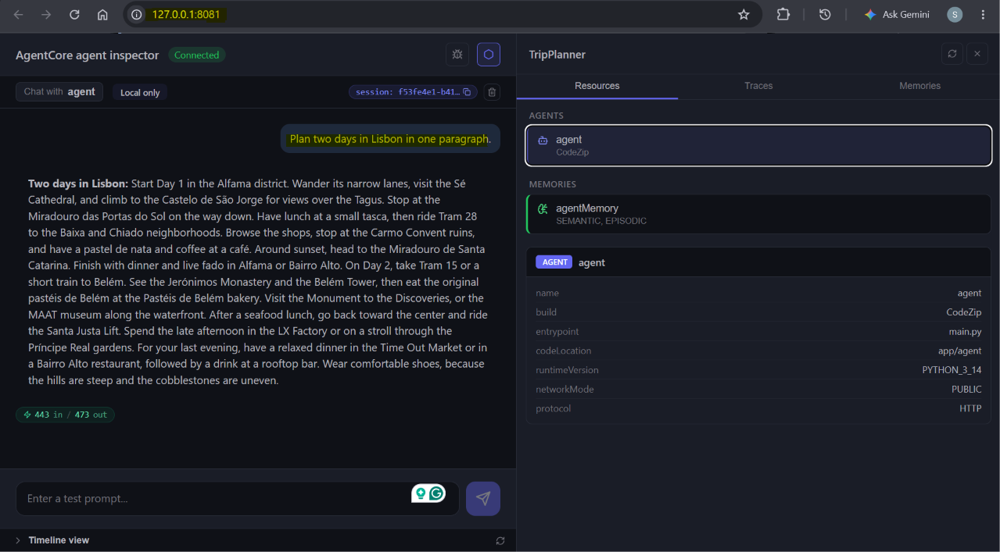
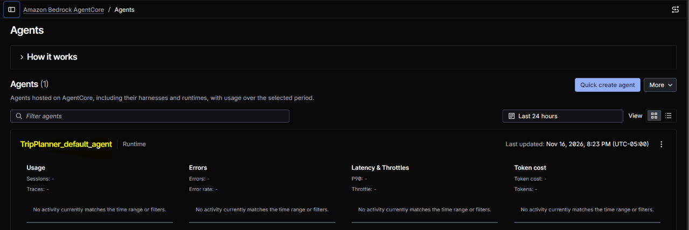

# AgentCore: `agentcore cli`

[Back](../README.md)

- [AgentCore: `agentcore cli`](#agentcore-agentcore-cli)
  - [1. Runtime](#1-runtime)
    - [Create project](#create-project)
    - [Understand the created files](#understand-the-created-files)
    - [Run the agent locally](#run-the-agent-locally)
    - [Build \& Deploy](#build--deploy)
    - [Invoke the deployed Runtime.](#invoke-the-deployed-runtime)
  - [Memory](#memory)
    - [Configure memory retrieval?](#configure-memory-retrieval)
  - [Clean up](#clean-up)

---

## 1. Runtime

### Create project

- ref: https://docs.aws.amazon.com/bedrock-agentcore/latest/devguide/agentcore-cli-get-started.html
  - Project name: TripPlanner
  - template: Python Strands
  - git: skip git as using a global .git instead of .git per lab

```sh
cd agentcore-cli

# create a Code-based agent project: using python strands template
agentcore create --name TripPlanner --template agent-python-strands --skip-git
```

---

### Understand the created files

```
MyProject/
├── .gitignore
├── agentcore/
│   ├── .env.local          # API keys (gitignored)
│   ├── agentcore.json      # Project specification (agents, memories, etc.)
│   ├── aws-targets.json    # Deployment targets (region, account)
│   └── cdk/                # CDK infrastructure (auto-managed)
└── app/
    └── agent/
        ├── .gitignore
        ├── README.md
        ├── main.py           # Agent entry point
        ├── memory/
        │   ├── __init__.py
        │   └── session.py    # AgentCore Memory session manager and retrieval settings.
        ├── model/
        │   ├── __init__.py
        │   └── load.py       # Model configuration (Claude on Bedrock)
        ├── parse.py
        └── pyproject.toml    # Python dependencies
```

---

### Run the agent locally

- CLI automatically:
  - Creates a Python virtual environment (.venv) if needed
  - Installs dependencies via uv sync
  - Start the local development server.

```sh
cd TripPlanner

# test with browser
agentcore dev --mode browser

# invoke the local agent.
agentcore invoke --runtime agent --local --payload "{\"prompt\":\"Plan two days in Lisbon in one paragraph.\"}"
```

> Debug: Authentication failed: Please make sure your API Key is valid.
> issue: could be the left-over API key
> Solution: remove the API key
> ps command:
> `[Environment]::SetEnvironmentVariable('AWS_BEARER_TOKEN_BEDROCK', $null, 'User')`
> `Remove-Item Env:AWS_BEARER_TOKEN_BEDROCK`



---

### Build & Deploy

- Build deployable artifacts
  - create files in `agentcore/cdk/cdk.out/`, ignoring by `.gitignore`

```sh
agentcore build
```

---

- Deploy
  1. Packages your code into a zip artifact
  2. Uses `AWS CDK` under the hood to synthesize and provision resources
  3. Creates an `AgentCore Runtime` endpoint for your agent
  4. Configures `CloudWatch` logging and observability

```sh
agentcore deploy

# verify
agentcore status --json
# {
#   "projectName": "TripPlanner",
#   "target": "default",
#   "region": "us-east-1",
#   "resources": [
#     {
#       "resourceType": "runtime",
#       "name": "agent",
#       "deploymentState": "deployed",
```

- Confirm in console



---

### Invoke the deployed Runtime.

- in console


```sh
agentcore invoke --runtime agent --payload "{\"prompt\":\"Plan two days in Lisbon in one paragraph.\"}"
# ...
# data: {"event": {"metadata": {"usage": {"inputTokens": 443, "outputTokens": 379, "totalTokens": 822}, "metrics": {"latencyMs": 4022}}}}
```

---

## Memory

Configure the agent to remember a preference from one session and apply it in a new session.

### Configure memory retrieval?

```sh
agentcore invoke --runtime agent --session-id trip-planner-preference-session-0001 --payload "{\"prompt\":\"I am Dana. I always want a window seat and I only eat vegetarian food.\"}"

agentcore memory record list --id TripPlanner_default_agentMemory-8Q5g124KN9 --namespace /users/default/preferences
```

## Clean up

```sh
agentcore remove all --yes
agentcore deploy --yes
```
